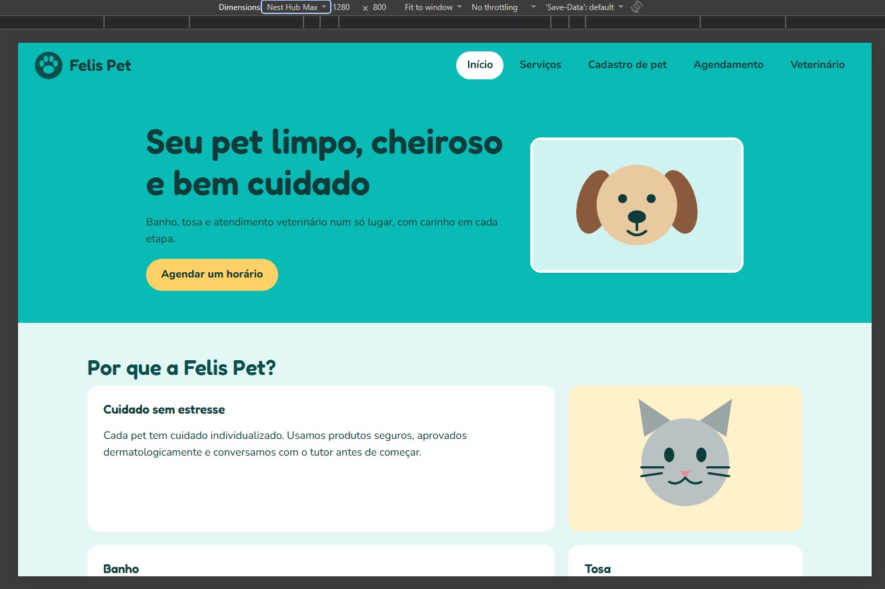
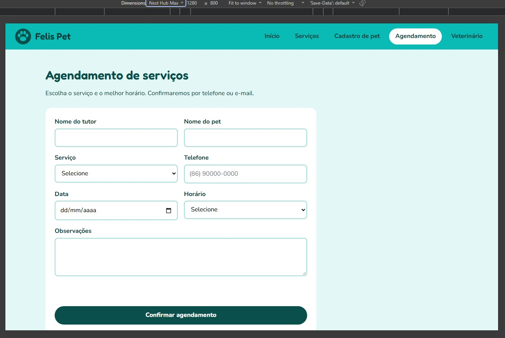
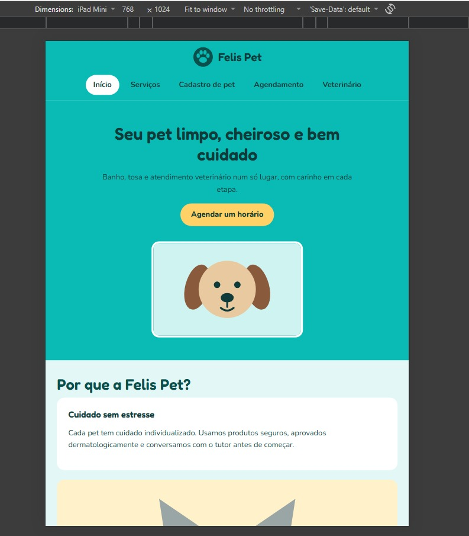
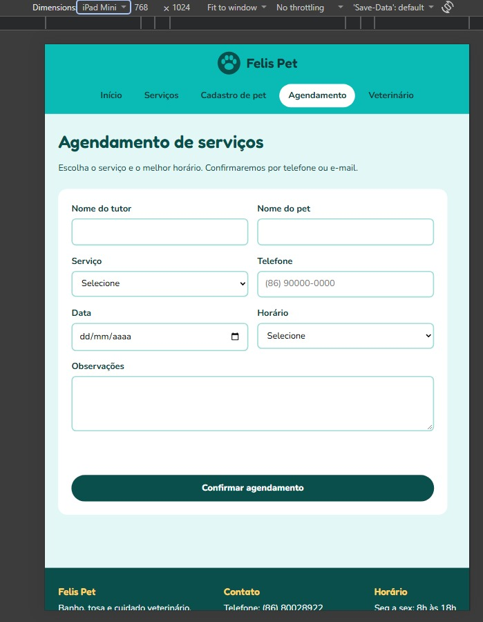
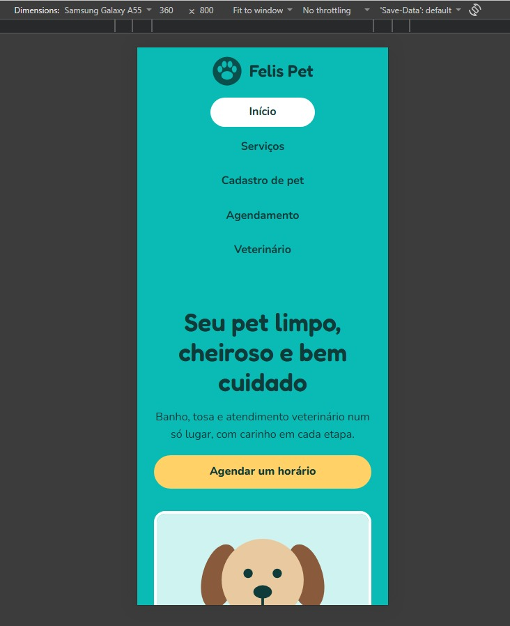
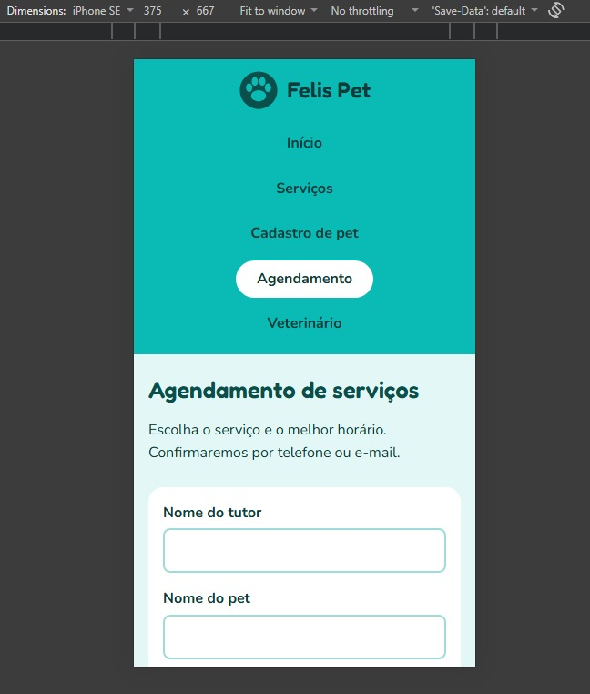

# FELIS PET – Banho e Tosa

Site responsivo de um petshop (HTML5 + CSS3) – Trabalho Final de Web Coding.

## Páginas HTML
`index.html` · `html/servicos.html` · `html/cadastro-pet.html` · `html/agendamento.html` · `html/veterinario.html`

## Estrutura
```
index.html   html/   css/style.css   images/    js/agendamentos     capturas/
```

## Onde foi aplicado
**Flexbox** (`display:flex`, `flex-direction`, `justify-content`, `align-items`, `flex-wrap`, `gap`): `.cabecalho` e `.menu__lista`, `.hero`, `.equipe` (lista de veterinários), `.formulario__linha`, `.rodape`.

**Grid**: `.grade` (6 cartões, `repeat(auto-fit, minmax(16rem, 1fr))`, usada em Serviços e Veterinário) e `.painel` (`grid-template-areas`, na home).

**Media Queries** (`@media screen`): `min-width:769px` (desktop), `max-width:768px` (tablet) e `max-width:480px` (smartphone). Alteram menu, hero, `.painel`, `.grade`, rodapé, botões e espaçamentos.

**BEM**: blocos `cabecalho`, `menu`, `hero`, `card`, `grade`, `painel`, `equipe`, `formulario`, `rodape`, `botao`; elementos como `card__titulo`; modificadores como `card--destaque`, `botao--destaque`, `menu__link--ativo`.

**Estados**: `:hover` em links, botões, cartões e campos; `:focus-visible` global.

## Capturas de tela

### Desktop (1440px)





### Tablet (768px)





### Smartphone (375px)





## Contato fictício
(86) 80028922 - contato@felispet.com.br


## Desafio escolhido: Ponto extra 

Conexão com banco de dados na aba de agendamentos: https://supabase.com/dashboard/project/mshdvgvmtyyhxqlienbo/editor/17644?schema=public
